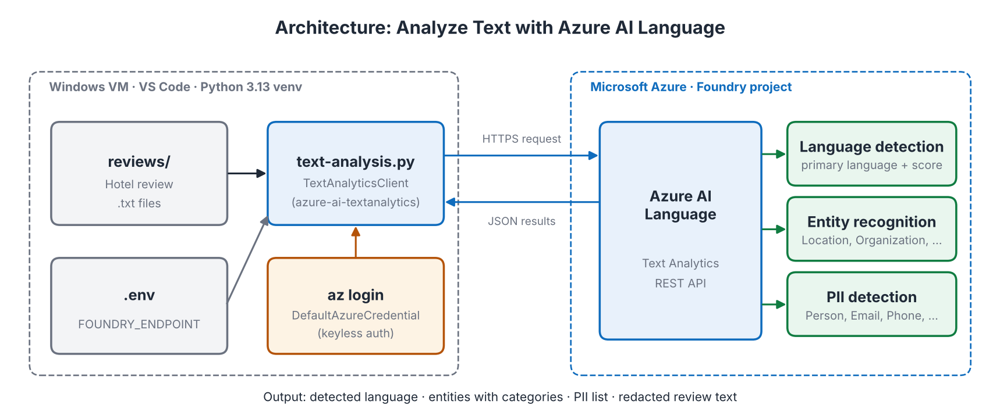
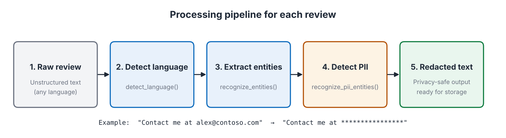
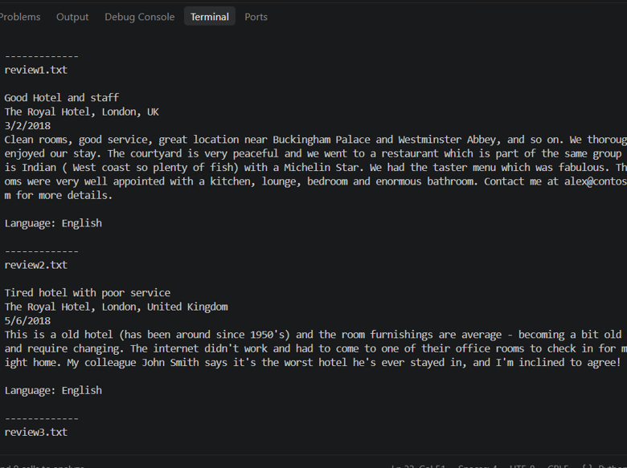
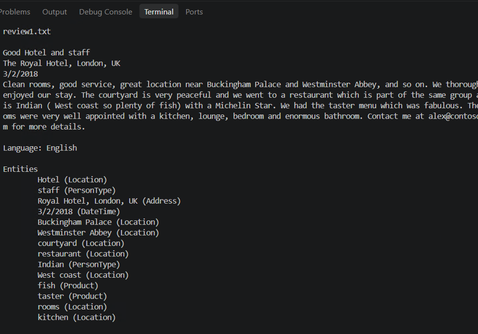
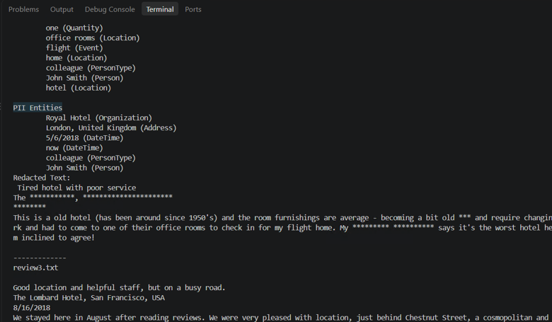
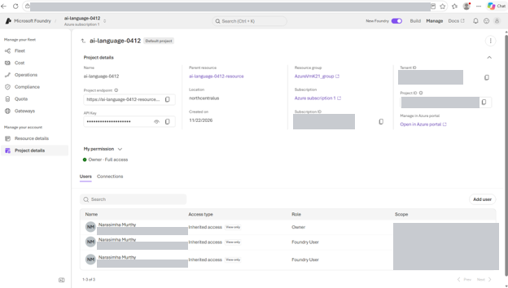
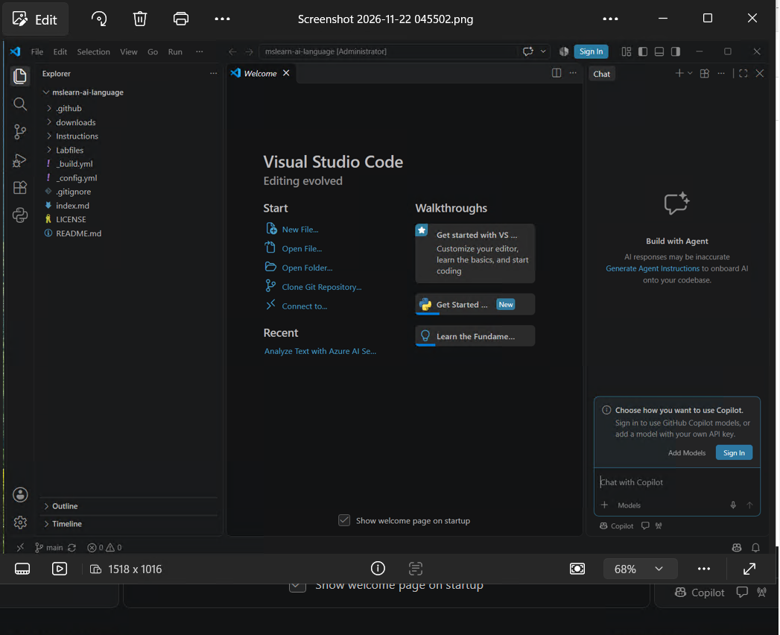
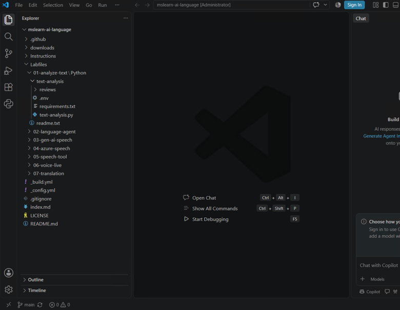

# Analyze Text with Azure AI Language


A Python NLP application that turns unstructured customer reviews into structured, privacy-safe data using **Azure AI Language** in a **Microsoft Foundry** project. It detects the language of each review, extracts named entities, and finds and redacts personally identifiable information (PII) before the data is stored or processed further.

Built and tested on a **Windows VM** with **VS Code** and **Python 3.13**.

---

## 📌 Scenario

A digital travel agency receives hotel reviews from customers around the world. As the AI Engineer, the goal is to build a text analysis solution that can automatically:

- Detect **which language** each review is written in
- Extract **key entities** such as locations, organizations and dates
- Identify and **redact PII** (names, email addresses, phone numbers) to meet data privacy requirements

## ✨ Features

| Feature | SDK method | Example output |
|---|---|---|
| 🌍 Language detection | `detect_language()` | `Language: French` |
| 🏷️ Named entity recognition | `recognize_entities()` | `Buckingham Palace (Location)` |
| 🔒 PII detection & redaction | `recognize_pii_entities()` | `alex@contoso.com (Email)` → `****************` |
| 📦 Batch processing *(extra)* | All of the above, in batches | Results saved to `output/results.json` |

## 🏗️ Architecture





## 🛠️ Tech Stack

- **Azure AI Language** (Text Analytics) in **Microsoft Foundry**
- **Python 3.13** with `azure-ai-textanalytics` 5.3.0
- **azure-identity** (`DefaultAzureCredential`) for keyless authentication via Azure CLI
- **python-dotenv** for configuration
- **Windows VM**, **VS Code**, **Git**

## 📁 Project Structure

```
AZURE-Analyze-Text-with-Azure-AI-Language-PII-Redaction-/
├── reviews/                 # Sample hotel reviews (English and French)
│   ├── review1.txt
│   ├── ...
│   └── review5.txt
├── images/                  # Architecture diagrams and screenshots
├── text-analysis.py         # Main app: one review at a time
├── text_analysis_batch.py   # Batch version: saves JSON + redacted files
├── requirements.txt         # Python dependencies
├── .env.example             # Configuration template (copy to .env)
├── .gitignore
├── LICENSE
└── README.md
```

## 🚀 Getting Started

### Prerequisites

- An Azure subscription (free tier works)
- A **Microsoft Foundry project** (this gives you an Azure AI Language endpoint)
- Python 3.13, Git, VS Code and the [Azure CLI](https://learn.microsoft.com/cli/azure/install-azure-cli)

### 1. Clone the repository

```powershell
git clone https://github.com/ms-murthy/AZURE-Analyze-Text-with-Azure-AI-Language-PII-Redaction-.git
cd AZURE-Analyze-Text-with-Azure-AI-Language-PII-Redaction-
```

### 2. Create a virtual environment and install dependencies

```powershell
python -m venv .venv
.venv\Scripts\activate
pip install -r requirements.txt
```

### 3. Configure the endpoint

Copy `.env.example` to `.env`:

```powershell
copy .env.example .env
```

Then set your Foundry resource endpoint in `.env`:

```
FOUNDRY_ENDPOINT=https://<your-foundry-resource-name>.services.ai.azure.com
```

> ⚠️ Use the **resource** endpoint ending in `.services.ai.azure.com`. Remove any `/api/projects/<project-name>` suffix copied from the Foundry portal.

### 4. Sign in to Azure

```powershell
az login
```

The app uses `DefaultAzureCredential`, so no API keys are stored in code or config. If you have subscriptions in several tenants, use `az login --tenant <tenant-id>`.

### 5. Run the app

```powershell
python text-analysis.py
```

Or run the batch version, which also saves the results:

```powershell
python text_analysis_batch.py
```

This writes:
- `output/results.json`: language, entities and PII for every review
- `output/redacted/`: a privacy-safe copy of each review

> 🔐 `output/` is git-ignored because `results.json` contains the original PII values.

## 📊 Results

Output from a real run of `text-analysis.py` on the sample hotel reviews.

### 1. Language detection

Each review's language is identified before further processing (English for the reviews shown here; review 5 is in French).



### 2. Named entity recognition

Entities found in `review1.txt`, with their categories:

```
Entities
        Hotel (Location)
        staff (PersonType)
        Royal Hotel, London, UK (Address)
        3/2/2018 (DateTime)
        Buckingham Palace (Location)
        Westminster Abbey (Location)
        ...
```



### 3. PII detection and redaction

PII found in `review2.txt`. The person's name, address and dates are masked in the redacted text:

```
PII Entities
        Royal Hotel (Organization)
        London, United Kingdom (Address)
        5/6/2018 (DateTime)
        now (DateTime)
        colleague (PersonType)
        John Smith (Person)
Redacted Text:
 Tired hotel with poor service
 The ***********, **********************
 ...My ********* ********** says it's the worst hotel he's ever stayed in...
```



## 🧪 Lab Walkthrough

**Microsoft Foundry project** with Azure AI Language (identifiers masked):



**Cloning the starter repository** in VS Code (`Git: Clone`):



**Lab files** in `Labfiles/01-analyze-text/Python/text-analysis`:



## 💡 Key Learnings

- **Keyless authentication:** `DefaultAzureCredential` with `az login` avoids hard-coded API keys, which is the recommended production pattern.
- **Privacy by design:** PII redaction belongs at ingestion, before text is stored, indexed or sent to downstream models.
- **Batching:** the main app makes one request per review for clarity. `text_analysis_batch.py` sends up to 5 reviews per request, which cuts the number of API calls.
- **Endpoint format matters:** the Language client needs the resource endpoint, not the Foundry project URL.
- **Cost awareness:** analyzing ~30 text records costs about **$0.017**. Delete the resource group when you're done to avoid ongoing charges.

## 🔭 Future Improvements

- [ ] Add sentiment analysis and opinion mining
- [ ] Add key phrase extraction
- [ ] Push enriched, redacted reviews into an **Azure AI Search** index for semantic search
- [ ] Wrap the analyzer in a FastAPI service or Azure Function
- [ ] Add a Streamlit dashboard to explore the results

## 🧹 Clean Up

To avoid charges, delete the resource group that holds your Foundry project: **Azure portal → Resource groups → your group → Delete resource group**.

## 🙏 Acknowledgements

- Based on the *Analyze Text* exercise from [Microsoft Learning – mslearn-ai-language](https://github.com/MicrosoftLearning/mslearn-ai-language) (MIT License), delivered as a hands-on lab by [K21Academy](https://www.linkedin.com/company/k21academy).
- [Azure AI Language documentation](https://learn.microsoft.com/azure/ai-services/language-service/overview)

## 📄 License

This project is licensed under the MIT License. See [LICENSE](LICENSE) for details.

---

**Connect with me:** [LinkedIn](https://www.linkedin.com/in/mmurthy25) · [GitHub](https://github.com/ms-murthy)
